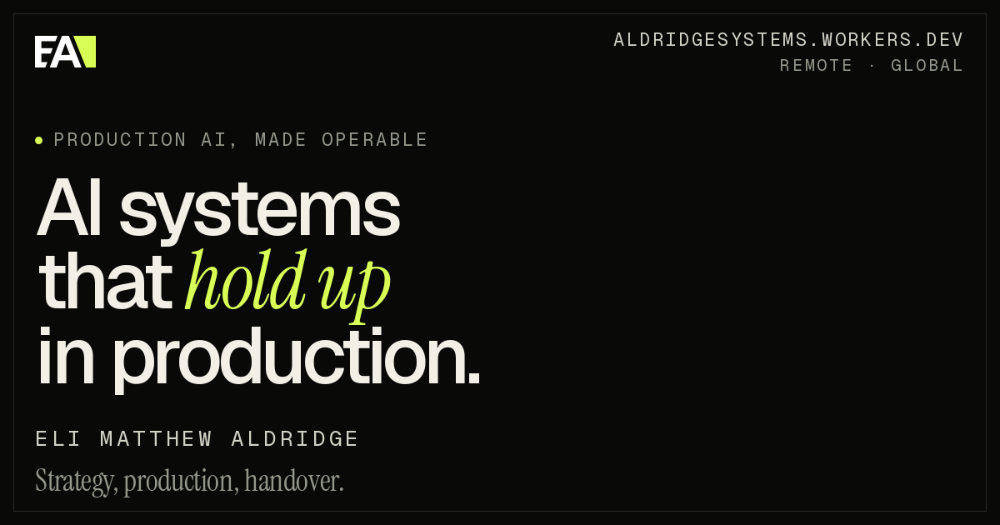

  

INDEPENDENT MLOPS CONSULTANT&nbsp;&nbsp;·&nbsp;&nbsp;ALDRIDGE SYSTEMS

6+ production systems shipped, from decisioning APIs and forecasting pipelines to governed LLM gateways. I leave behind evals, runbooks, and observability — so your team can run it without me.

**Stack:** Python · Kubernetes · Terraform · Dagster · vLLM · OPA · OpenTelemetry · Postgres · ClickHouse

**Links:** [Email](mailto:test.academy24@gmail.com) · [X](https://x.com/TheLabAIRat) · [GitHub](https://github.com/TheLabAIRat)
